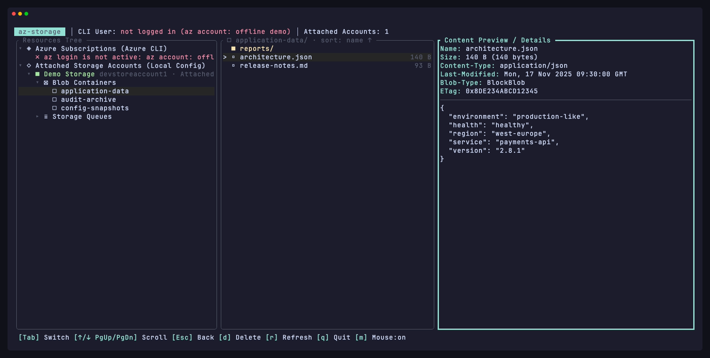
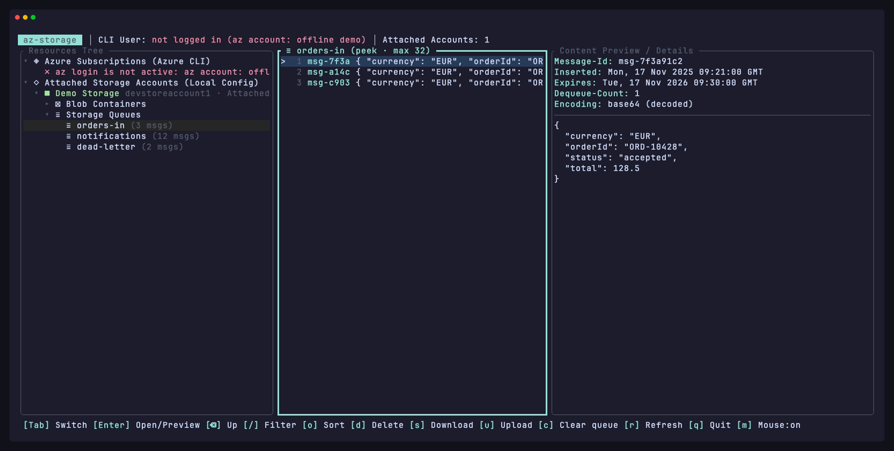

# az-storage

Terminal UI for exploring and managing Azure Storage Accounts (Blob Containers and Storage Queues). Built with Rust, Ratatui, and Tokio.

## Features

- **Hybrid account discovery**: unifies two account sources in a single resource tree:
  - **Azure Subscriptions** discovered automatically from an active `az login` session via Azure Resource Manager (ARM), resolving data-plane keys via `listKeys` with fallback to `https://storage.azure.com/` Bearer tokens when key listing is restricted.
  - **Attached Accounts** configured manually with connection strings, SAS URLs, or `UseDevelopmentStorage=true` for local Azurite emulators.
- **Blob container browser**: hierarchical folder navigation using `/` delimiters, parent directory traversal, live substring filtering (`/`), and four sort modes (`name ↑`, `name ↓`, `size ↓`, `newest`, with folders always listed first).
- **Content and folder preview**: inspects the first 512 KB of a selected blob via HTTP range requests with pretty-printed JSON and metadata (size, content type, last modified), and previews subdirectory contents without opening them.
- **Streaming uploads and downloads**: download blobs or folders and upload local files with live transfer progress bars, overwrite toggle (`Ctrl+O`), and in-flight transfer cancellation (`x`).
- **Storage Queue inspection**: non-destructive peek of up to 32 queue messages, individual message deletion, and full queue clearing (`c`) with explicit confirmation.
- **Keyboard and mouse support**: click to focus/expand/select, scroll with mouse wheel, or press `m` to toggle mouse capture for native terminal text selection.
- **Non-blocking architecture**: Azure CLI subprocesses, ARM discovery, and data-plane REST calls run on a dedicated Tokio worker thread.

## Screenshots





## Installation

### Prerequisites

- Rust 1.85 or newer (edition 2024)
- Optional: [Azure CLI](https://learn.microsoft.com/cli/azure/install-azure-cli) logged in with `az login` for automatic subscription discovery

### Build from source

```sh
cargo build --release
```

The compiled binary is written to `target/release/az-storage`.

Run directly with Cargo:

```sh
cargo run --bin az-storage
```

## Configuration

Manually attached accounts are saved in JSON format with owner-only permissions (`0600` on Unix):

- macOS: `~/Library/Application Support/azure-storage-tui/config.json`
- Linux: `~/.local/share/azure-storage-tui/config.json`
- Windows: `%APPDATA%\azure-storage-tui\config.json`

The `azure-storage-tui` directory name is preserved for backwards compatibility with existing configurations.

Example `config.json`:

```json
{
  "attached_accounts": [
    {
      "name": "dev-azurite",
      "connection_string": "UseDevelopmentStorage=true"
    },
    {
      "name": "partner-storage",
      "connection_string": "DefaultEndpointsProtocol=https;AccountName=<name>;AccountKey=<key>;EndpointSuffix=core.windows.net"
    }
  ]
}
```

Attached accounts can also be added (`a`) and detached (`d` on an attached account in the sidebar) directly from the UI.

### Icons

Icons use standard Unicode symbols, which render with any monospace font. If your terminal uses a
[Nerd Font](https://www.nerdfonts.com/), you can switch to Nerd Font glyphs with `"nerd_font_icons": true`
in `config.json` or with the `AZ_STORAGE_ICONS=nerd` environment variable (`AZ_STORAGE_ICONS=unicode`
forces the default set). Without a Nerd Font those glyphs appear as missing-character boxes.

## Controls

### Global

| Key | Action |
|---|---|
| `Tab` / `Shift+Tab` | Cycle focus between Resource Tree, Item List, and Preview Inspector |
| `/` | Filter items in the current container or queue (`Enter` applies, `Ctrl+U` clears, `Esc` cancels) |
| `a` | Attach a Storage Account via connection string or SAS URL |
| `d` / `Delete` | Delete selected blob/message or detach selected manual account (requires confirmation) |
| `s` | Download selected blob |
| `u` | Upload local file to the current container/prefix |
| `c` | Clear all messages in the active Storage Queue (requires confirmation) |
| `x` | Cancel active transfers |
| `m` | Toggle mouse capture (disable for native terminal text selection) |
| `q` / `Ctrl+C` | Quit |

### Panel navigation

| Panel | Keys | Action |
|---|---|---|
| **Resource Tree** | `j`/`k`/`Up`/`Down`, `PgUp`/`PgDn`, `g`/`G` | Move selection |
| | `Enter` / `Space` | Expand/collapse node or open container/queue |
| | `l` / `Right` / `h` / `Left` | Expand / collapse node |
| | `r` | Refresh subscriptions and accounts |
| **Item List** | `j`/`k`/`Up`/`Down`, `PgUp`/`PgDn`, `g`/`G` | Move selection |
| | `Enter` / `l` / `Right` | Open folder or preview item |
| | `Backspace` / `h` / `Left` / `Esc` | Go to parent folder (or clear active filter) |
| | `o` | Cycle sort mode (`name ↑`, `name ↓`, `size ↓`, `newest`) |
| | `r` | Refresh current listing |
| **Preview Inspector** | `j`/`k`/`Up`/`Down`, `PgUp`/`PgDn`/`Space`, `g` | Scroll preview content |
| | `Esc` / `Backspace` / `h` / `Left` | Return focus to Item List |

## Architecture

`az-storage` uses a decoupled two-thread async worker architecture: the main thread runs the Ratatui render loop and terminal event handling without blocking on I/O, while a Tokio worker handles `az account get-access-token` subprocesses, ARM discovery, SharedKey (HMAC-SHA256) / Bearer / SAS authentication, and Blob/Queue REST API calls (`x-ms-version: 2023-11-03`) over `tokio::sync::mpsc` channels. A panic hook restores terminal state on unexpected exit.

```
az-storage/
├── src/
│   ├── main.rs      # Terminal setup, panic/restore hook, event loop
│   ├── app.rs       # UI state machine, tree model, filtering, sorting, input handling
│   ├── ui.rs        # Ratatui layout, panels, transfer bar, modals
│   ├── worker.rs    # Async Tokio worker for ARM discovery, data-plane ops, transfers
│   ├── auth.rs      # Azure CLI token provider, connection string & SAS parsing, SharedKey HMAC-SHA256
│   ├── arm.rs       # ARM subscription, storage account, and listKeys clients
│   ├── storage.rs   # Blob Storage and Storage Queue REST clients
│   ├── model.rs     # Shared domain types
│   └── config.rs    # Local attached-account persistence
└── Cargo.toml
```
